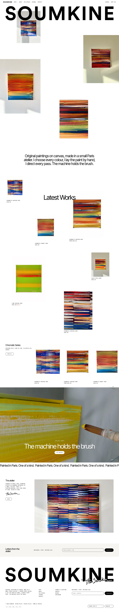
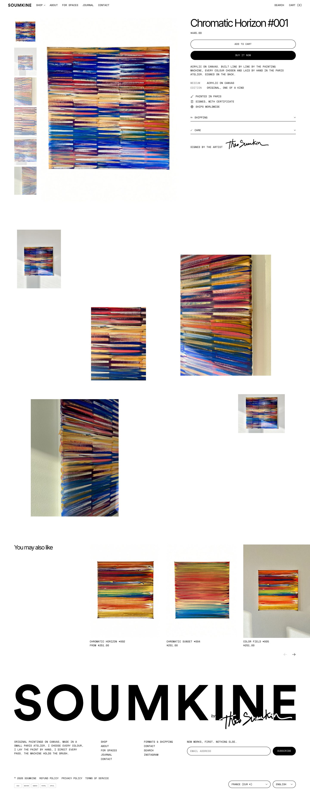
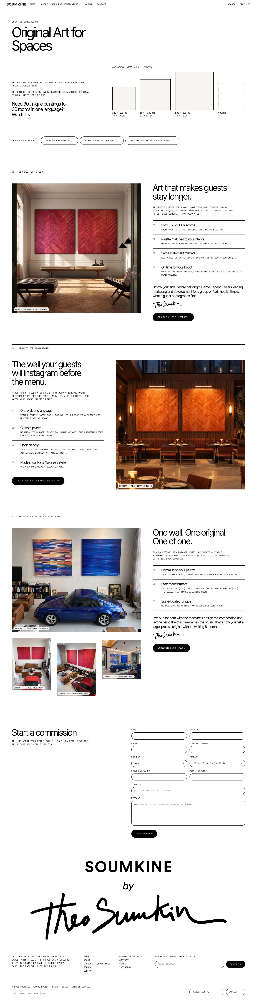
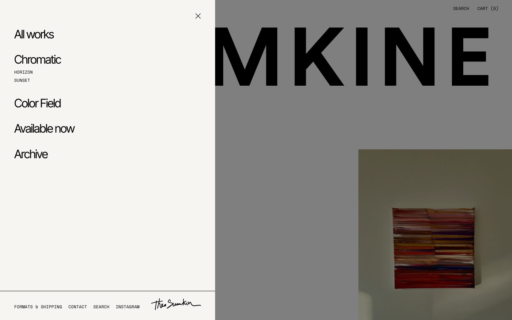
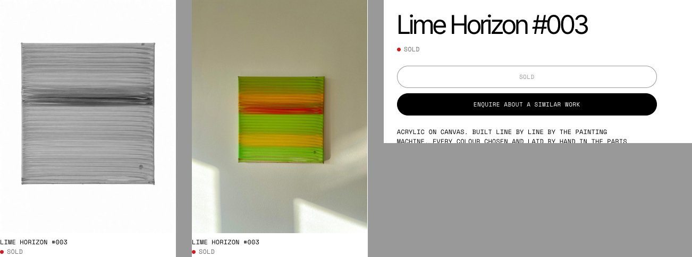

# SOUMKINE — custom Shopify theme

A custom Shopify theme built for **SOUMKINE**, the art brand founded by painter Theo Sumkin: original paintings on canvas from a small Paris atelier.

**Design & development: Yury Melnikau** · Version 0.4.0 · Online Store 2.0

<p>
  <a href="soumkine-preview/1-home-desktop.jpg"></a>
  <a href="soumkine-preview/2-product.jpg"></a>
  <a href="soumkine-preview/10-commissions-desktop.jpg"></a>
</p>

*Home · Artwork page · Commissions landing — click to open full size.*

## Highlights

- **Hero collage.** An oversized SOUMKINE wordmark with artwork photos scattered around it. Each photo's width, position, layer (in front of or behind the wordmark) and parallax are set in the theme editor. With no photos chosen, the theme uses the products' wall shots.
- **Scattered collection.** "Latest Works" as an asymmetric grid that reads like a hung exhibition, not a product grid.
- **Sold works, gallery-style.** A red dot and SOLD instead of a price. The card image turns black-and-white and regains colour on hover. "Add to cart" becomes "Enquire about a similar work".
- **Commissions landing page.** Separate sections for hotels, restaurants and private collections, each with its own call to action. Buttons scroll to the enquiry form and pre-select the project type; links like `?project=Hotel#enquire` do the same. Concept images carry an "AI-generated image" label, shortened on phones.
- **Video feature.** A muted, looping atelier video that plays only while on screen and stays paused once a visitor pauses it. Autoplay modes: always, desktop only, or off; optional play/pause button.
- **Slide-in menu.** Nested menu items open as large headings, third-level links in monospace, footer menu at the bottom of the panel.
- **Vector logo lockup.** SOUMKINE / by / signature rebuilt as an SVG sprite from the outlined Illustrator master, sharp at any size. On phones only one logo is visible at a time: the header wordmark appears once the hero wordmark scrolls away.
- **Artwork details.** Medium, size, year and edition, connectable to product metafields.
- **Full store.** Cart drawer, predictive search, filters, journal, customer accounts, password page, gift card, 404.

<p>
  
  
</p>

More screenshots: [home on mobile](soumkine-preview/5-home-mobile.jpg) · [commissions on mobile](soumkine-preview/11-commissions-mobile.jpg) · [collection](soumkine-preview/3-collection.jpg) · [commissions menu](soumkine-preview/12-commissions-menu.jpg) · [video button](soumkine-preview/9-video-button.jpg) · [footer logo](soumkine-preview/7-footer-logo.jpg) · [AI label on mobile](soumkine-preview/13-ai-label-mobile.jpg)

## Under the hood

- Liquid, Online Store 2.0: JSON templates, section groups, sections everywhere.
- Vanilla JavaScript (custom elements) in one deferred file; one CSS file built on custom properties. No build step, no third-party scripts.
- Self-hosted fonts under the SIL Open Font License: Space Mono, Inter Tight, Antonio.
- Respects "reduce motion": parallax and reveal animations switch off.

## Repository

| Path | Contents |
|---|---|
| `soumkine-theme/` | Theme source |
| `SOUMKINE-theme-setup.md` | Setup guide (in Russian) |
| `soumkine-preview/` | Screenshots |
| `IMAGE 2026-…jpg`, `image*.jpg`, `cover_40x40*.jpg` | Artwork photos |
| `commission-images/` | Images for the commissions page |
| `signature_sumkin*` | Logo and signature (SVG, PNG, AI) |
| `soumkine-atelier-video.mp4` | Atelier video, H.264 for the web |
| `header_video_2_2x_noaudio.mp4` | Original of the same video |
| `*SOUMKINE-actual.pdf` | The store before this theme |

## Install

Download `soumkine-theme-0.4.zip` from the [v0.4.0 release](https://github.com/forma78/Shopify-Soumkine/releases/tag/v0.4.0), then in Shopify Admin: **Online Store → Themes → Add theme → Upload zip file**.

To build the zip from source:

```sh
cd soumkine-theme && zip -r ../soumkine-theme-0.4.zip . -x '.*'
```

## Credits & copyright

- Theme design and code © 2026 Yury Melnikau. All rights reserved.
- Brand, paintings, photographs, video, logo and signature © Theo Sumkin, SOUMKINE. All rights reserved.
- Fonts: SIL Open Font License 1.1, by their authors.

See [LICENSE](LICENSE).
